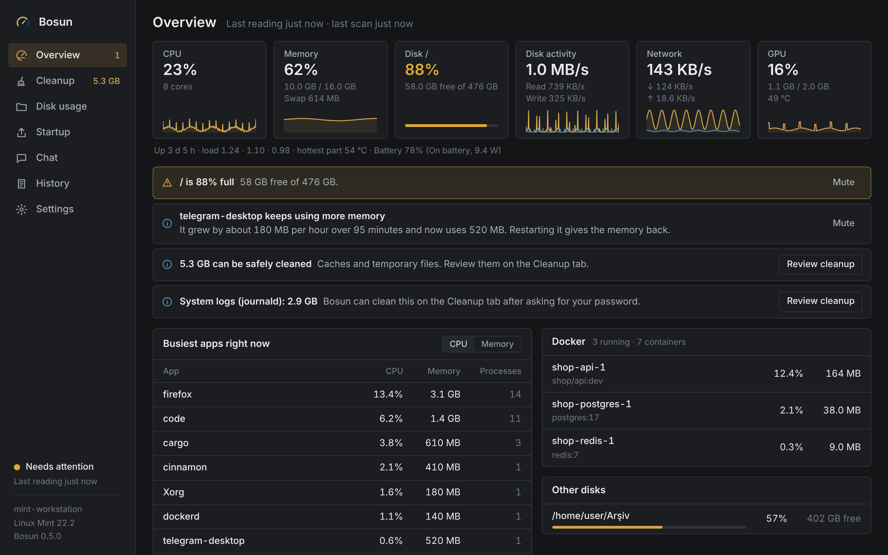
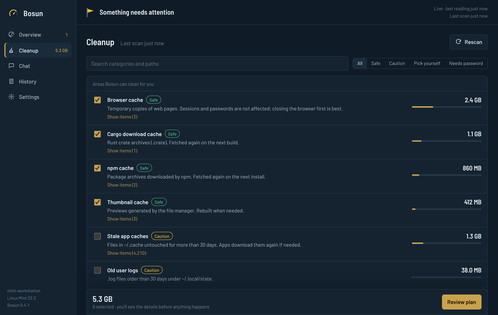
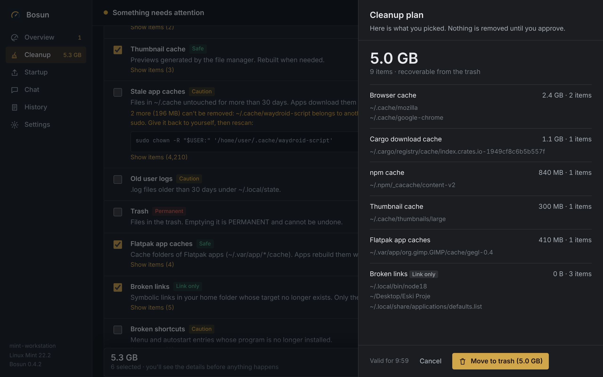
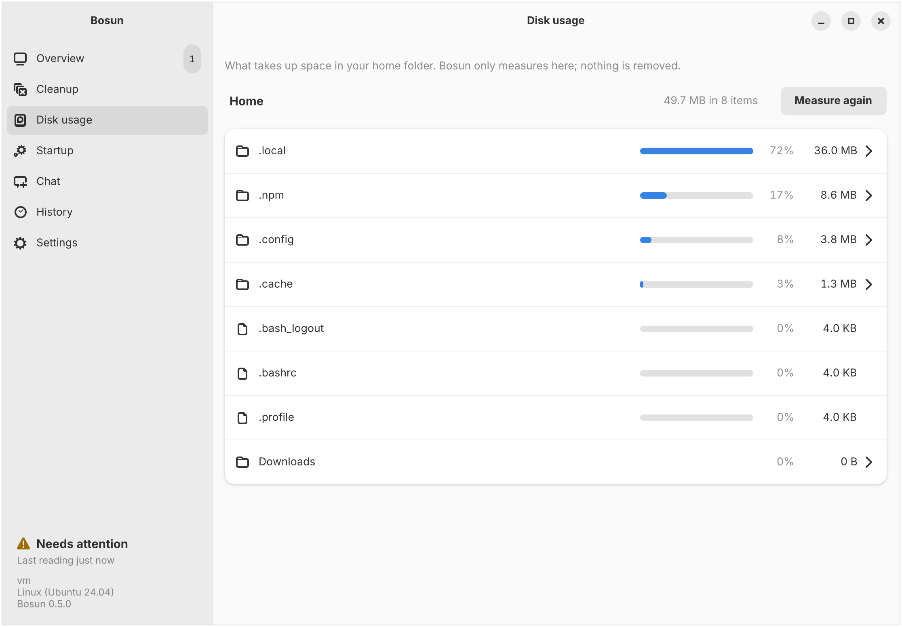
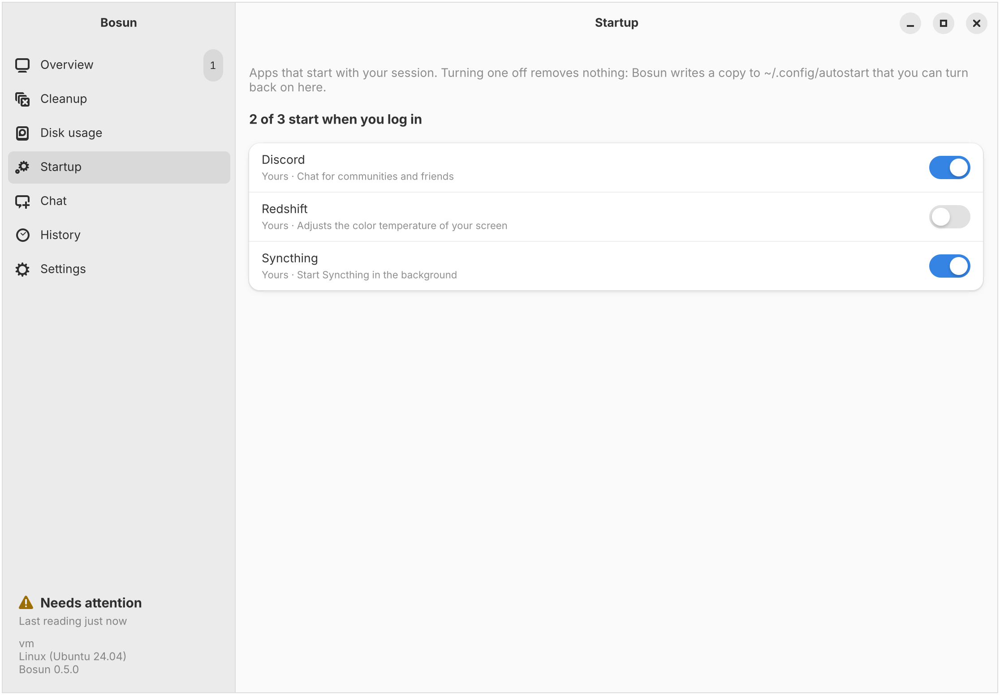
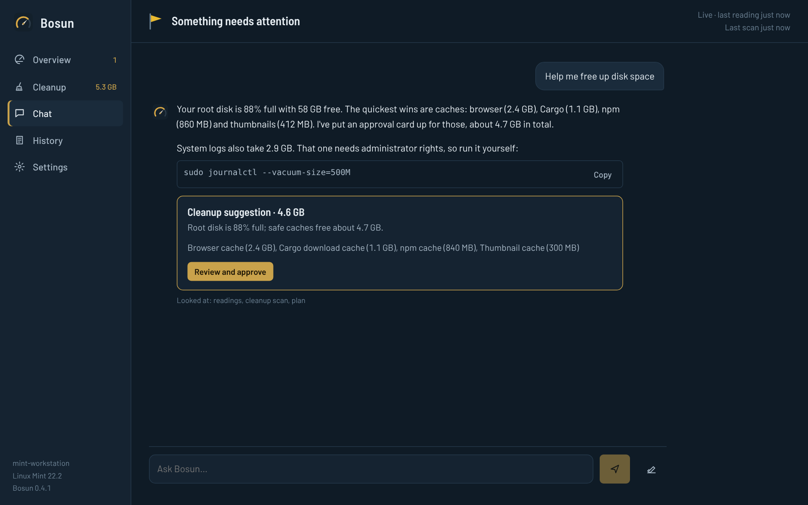
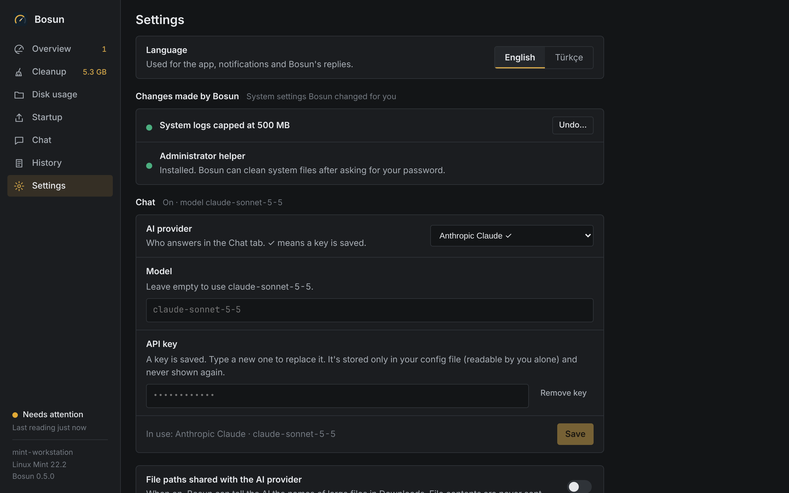

<p align="center">
  
</p>

<h1 align="center">Bosun</h1>

<p align="center">
  A maintenance assistant for the Linux desktop. It watches your system, explains what it sees,<br>
  finds what can be cleaned and suggests better settings — and changes nothing until you approve.
</p>

<p align="center">
  <a href="https://github.com/kaptanoguz/Bosun/releases/latest"></a>
  <a href="https://github.com/kaptanoguz/Bosun/actions/workflows/ci.yml"></a>
  <a href="LICENSE"></a>
  
  
</p>

<p align="center">
  <a href="https://kaptanoguz.github.io/Bosun/"><b>Website</b></a> ·
  <a href="https://github.com/kaptanoguz/Bosun/releases/latest">Download</a> ·
  <a href="#install">Install</a> ·
  <a href="#safety">Safety</a> ·
  <a href="README.tr.md">Türkçe</a>
</p>



On a ship, the bosun keeps the deck in order. Bosun does the same for a Linux machine: a small background service measures the system every few seconds, a desktop app shows the readings and what needs attention, and an optional AI chat answers questions using those real readings.

## What it does

**Watch.** CPU, memory, swap, disk space, disk activity, network, battery, GPU (NVIDIA and AMD) and load, each with the last hour. The busiest apps right now (processes grouped by program) and a summary of running Docker / Podman containers. Desktop notifications for full disks, a CPU that stays busy (naming the app behind it), sustained memory pressure, an app whose memory keeps growing for a long time, heat, low battery and failed systemd services. Any finding can be muted.

**Clean.** Bosun scans for space it can reclaim and groups it by how safe it is:

| | |
|---|---|
| Caches | Browser, thumbnails, npm, Cargo, pip / uv / Poetry / conda / Go / Yarn / Gradle, Flatpak apps, Steam shaders, stale `~/.cache` files |
| Leftovers | Broken symbolic links, menu and autostart entries whose program is gone, settings folders of programs that look uninstalled (a guess — never pre-selected, with a "look inside" preview) |
| Logs and trash | Old user logs, the trash (marked as permanent) |
| System (asks for your password) | systemd journal, APT cache, unused Flatpak runtimes, packages nothing needs (`autoremove`), configs of removed packages |
| Containers | Docker / Podman dangling images and build cache only — never tagged images, containers or volumes |
| Large files | Files over 500 MB in Downloads — listed, never selected for you |



Every cleanup goes through a plan you review first. Files go to the trash, so they can be restored.



**Find what takes up space.** Disk usage shows what fills your home folder, biggest first, and lets you click down into any folder. Folders where Bosun can clean something are marked. This screen only measures; it never removes anything.



Once a week, if more than 1 GB can be freed, Bosun sends a notification saying how much. It is a reminder only; turn it off in Settings.

**Startup.** See the apps that start when you log in and turn them off or back on. Nothing is deleted: Bosun writes a copy to `~/.config/autostart` with `Hidden=true`. Parts of the desktop (keyring, polkit agent, settings daemon…) can't be turned off.



**Tune.** Suggestions with the exact change they make: cap the systemd journal, keep fewer Snap revisions, lower swappiness on machines with plenty of RAM. Apply them with one click (your system asks for your password) and undo them later from Settings.

**Talk.** Ask Bosun about your system. Replies stream in as they're written, numbers come from live readings rather than guesses, and when it suggests a cleanup it puts up an approval card instead of acting on its own. Works with Anthropic Claude, xAI Grok, Google Gemini, OpenAI, or any OpenAI-compatible local server such as Ollama or LM Studio — with a local model, nothing leaves your computer.



Everything else — monitoring, findings, cleanup — works without an AI provider.

## Install

Bosun is built and tested on Linux Mint 22 and Ubuntu 24.04 (x86-64). Grab the files from the [latest release](https://github.com/kaptanoguz/Bosun/releases/latest).

**.deb** — installs the app, the background service, the administrator helper and its polkit rule. apt pulls in GTK 4 and libadwaita if they are missing:

```bash
sudo apt install ./bosun_*_amd64.deb
systemctl --user enable --now bosund      # or press "Start service" in the app
```

After an upgrade, restart the service so the new version takes over (the app reminds you if they differ):

```bash
systemctl --user daemon-reload && systemctl --user restart bosund
```

Verify a download with `sha256sum -c SHA256SUMS` (and `gpg --verify SHA256SUMS.asc` when a signature is attached).

**From source:**

```bash
git clone https://github.com/kaptanoguz/Bosun.git && cd Bosun
./install.sh            # service only, into ~/.local/bin
./install.sh --helper   # service + administrator helper (asks for sudo)
./install.sh --app      # build the full .deb (needs libgtk-4-dev and libadwaita-1-dev)
```

## Set up chat

Open **Settings → Chat**, choose a provider, paste an API key and save. Leave the model empty to use the default, or type any model the provider offers.

| Provider | Default model | Notes |
|---|---|---|
| Anthropic Claude | `claude-sonnet-5-5` | |
| xAI Grok | `grok-4.5` | OpenAI-compatible API |
| Google Gemini | `gemini-3.8-flash` | Gemini's OpenAI-compatible endpoint |
| OpenAI | `gpt-5` | |
| Custom server | `llama3.1` | e.g. Ollama at `http://localhost:11434/v1`; no key needed |

Keys are stored per provider in `~/.config/bosun/config.toml` (mode `0600`) and are never sent back to the app. File contents are never shared with the provider; names of large files are shared only if you turn that on.



## Safety

Bosun deletes things on a computer you care about, so it is deliberately cautious.

- **Nothing happens without approval.** A cleanup plan is tied to a SHA-256 digest of its exact contents, expires after 10 minutes and can be applied only once. The AI can propose a plan but has no tool to apply one.
- **Recoverable by default.** Files go to the trash. The only permanent operations are emptying the trash (clearly marked) and removing broken links, where only the link itself is deleted.
- **Protected paths.** System folders (`/usr`, `/etc`, `/boot`, …), your home folder itself and personal folders (Documents, Pictures, Desktop, …) are never touched. Each path is re-validated right before removal: canonicalised, symbolic links and `..` escapes rejected, and it must sit inside the category's own folder.
- **Least privilege.** The service runs as you, never as root. System work is done by `/usr/lib/bosun/bosun-helper`, a tiny dependency-free program started through `pkexec`. It accepts a single word from a fixed list of actions — no paths, numbers or commands — and the confirmation window shows exactly which commands will run as root. Bosun refuses to use the helper if it isn't owned by root or is writable by others, and looks for `pkexec` only in system locations, never on `PATH`.
- **Local only.** The service listens on a Unix socket in your runtime directory (`0600`) and accepts connections only from your own user ID.
- **Audited.** Every plan, approval and administrator action is written to `~/.local/state/bosun/audit.jsonl` and shown under History.

## How it works

```
Bosun app (GTK 4 + libadwaita)  ⇄  Unix socket, NDJSON  ⇄  bosund (Rust, systemd --user)
                                                          ├─ sampler (every 5 s)
                                                          ├─ scanner (every 10 min, cancellable)
                                                          ├─ rules → desktop notifications
                                                          ├─ AI agent (read-only tools + "propose plan")
                                                          └─ plan → approval → trash
bosun-helper (root, via pkexec) ← fixed actions only, launched by the app
```

| Path | Contents |
|---|---|
| `crates/bosun-core` | Metrics, scanning, safety policy, plans, rules, advice, IPC types |
| `crates/bosund` | Background service and AI agent |
| `crates/bosun-helper` | Administrator helper (no dependencies) |
| `crates/bosun-gtk` | Desktop app (GTK 4 + libadwaita); UI text in `locales/en.json` and `tr.json` |
| `packaging/` | `.deb` build script, systemd units, polkit policy, desktop entry, icons, example config |

The full design, including the safety model and IPC protocol, is in [PLAN.md](PLAN.md) (Turkish).

## Configuration

Most options are in the app. Everything lives in `~/.config/bosun/config.toml`; see [packaging/config.example.toml](packaging/config.example.toml) for thresholds (disk, memory, swap, temperature, staleness, large-file size) and intervals. Restart the service after editing by hand.

## Development

```bash
cargo test --workspace          # unit tests + integration tests against the real service
cargo run -p bosund             # run the service in the foreground (BOSUN_LOG=debug)
cargo run -p bosun-gtk          # the desktop app (service must be running)
packaging/build-deb.sh          # build target/debian/bosun_<version>_amd64.deb
```

Building the app needs `libgtk-4-dev` (4.14 or newer) and `libadwaita-1-dev` (1.5 or newer), as on Ubuntu 24.04 and Linux Mint 22.

The project website lives in `site/` and is published to [kaptanoguz.github.io/Bosun](https://kaptanoguz.github.io/Bosun/) by the Pages workflow whenever `site/`, the logo or the screenshots change on `main`; it reuses the images in `docs/screenshots`.

CI runs `cargo fmt`, `clippy -D warnings` and the tests, and builds the `.deb` on every push and pull request (download it as `bosun-deb` from the run's page). To release, bump the version in `Cargo.toml`, move the changelog entries under the new version and merge to `main`: the release workflow then tags `vX.Y.Z`, builds the `.deb`, writes `SHA256SUMS` and publishes a release with notes from [CHANGELOG.md](CHANGELOG.md). Pushing a tag such as `v0.6.0` by hand works too.

## Reporting problems

**Settings → Report a problem → Copy diagnostics** copies versions, service status and recent log lines (API keys are redacted). Paste it into a [GitHub issue](https://github.com/kaptanoguz/Bosun/issues).

## License

[MIT](LICENSE)
