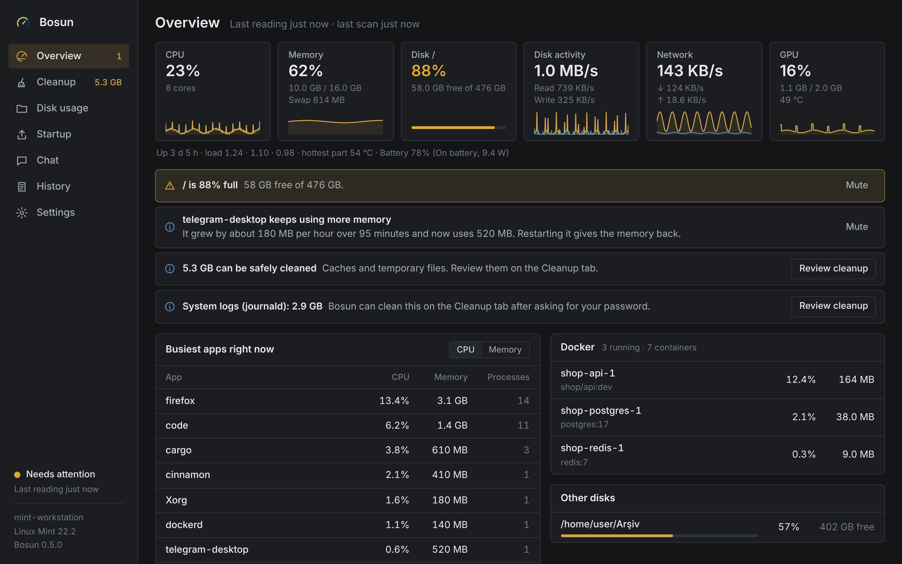

<p align="center">
  
</p>

<h1 align="center">Bosun</h1>

<p align="center">
  <a href="https://github.com/kaptanoguz/Bosun/releases/latest"></a>
  <a href="https://github.com/kaptanoguz/Bosun/actions/workflows/ci.yml"></a>
  <a href="LICENSE"></a>
</p>

<p align="center">
  <a href="https://kaptanoguz.github.io/Bosun/?lang=tr"><b>Web sitesi</b></a> ·
  <a href="https://github.com/kaptanoguz/Bosun/releases/latest">İndir</a> ·
  <a href="README.md">English</a> · <b>Türkçe</b>
</p>



Linux masaüstünüzün lostromosu. Sistemi sürekli izler, ne gördüğünü seçtiğiniz dilde (İngilizce ya da Türkçe) anlatır, gereksiz dosyaları bulur, ayar önerir ve **yalnızca sizin onayınızla** temizler.

- **Genel bakış:** işlemci, bellek, swap, disk alanı, disk etkinliği, ağ ve GPU kartları (son bir saatle birlikte), şu an en meşgul uygulamalar, çalışan Docker/Podman kapsayıcıları, bulgular ve ayar önerileri. İşlemci uzun süre meşgul kalırsa hangi uygulamanın yüzünden olduğunu, bir uygulamanın belleği saatlerce düzenli büyürse bunu da bildirir.
- **Disk kullanımı:** ev klasörünüzde yeri neyin kapladığı, büyükten küçüğe; herhangi bir klasöre tıklayıp içine inebilirsiniz. Bosun'un bir kısmını temizleyebileceği klasörler işaretlenir. Bu ekran yalnızca ölçer, hiçbir şey silmez.
- **Haftalık hatırlatma:** 1 GB'tan fazla yer açılabiliyorsa haftada bir bildirim ne kadar olduğunu söyler. Yalnızca hatırlatır; Ayarlar'dan kapatılabilir.
- **Başlangıç:** oturum açılınca başlayan uygulamaları açıp kapatın. Hiçbir şey silinmez; Bosun `~/.config/autostart` içine `Hidden=true` ile bir kopya yazar. Masaüstünün parçaları (anahtar zinciri, polkit ajanı…) kapatılamaz.
- **Temizlik:** önbellekler (tarayıcı, Flatpak, npm, Cargo…), eski günlükler, çöp kutusu, indirilenlerdeki büyük dosyalar ve eski programlardan kalanlar (kırık bağlantılar, kırık kısayollar, sahipsiz ayar klasörleri); her biri boyutu ve güvenlik seviyesiyle.
- **Yönetici işleri:** sistem günlükleri, APT önbelleği, kullanılmayan Flatpak ortamları, artık paketler ve kaldırılmış paketlerin ayarları tek tıkla temizlenir. journald sınırı, swappiness ve Snap sürüm sayısı önerileri uygulanabilir ve Ayarlar'dan geri alınabilir. Şifreyi sisteminizin kendi penceresi sorar.
- **Sohbet:** sisteminiz hakkında konuşun. Sağlayıcı seçilebilir: Anthropic Claude, xAI Grok, Google Gemini, OpenAI ya da OpenAI uyumlu yerel bir sunucu (Ollama, LM Studio). Bosun sayıları uydurmaz, ölçümlerden okur; bir şey silmeyi önerirse onay kartı gösterir.
- **Geçmiş:** yapılan her işlemin kaydı.
- **Ayarlar:** dil seçimi (varsayılan İngilizce, Türkçe seçilebilir). Dil; arayüz, bildirimler, bulgular ve Bosun'un sohbet yanıtları için birlikte değişir.

## Mimari

```
Bosun (GTK 4 + libadwaita)  ⇄  Unix socket (NDJSON)  ⇄  bosund (Rust, systemd --user)
                                                        ├─ örnekleyici (5 sn)
                                                        ├─ tarayıcı (10 dk)
                                                        ├─ kural motoru → notify-send
                                                        ├─ Claude ajanı (salt okuma araçları)
                                                        └─ plan → onay → çöp kutusu
```

| Klasör | İçerik |
|---|---|
| `crates/bosun-core` | Metrikler, tarama, güvenlik politikası, plan/onay, kurallar, öneriler, IPC tipleri |
| `crates/bosund` | Arka plan servisi |
| `crates/bosun-helper` | Yönetici yetkisiyle çalışan küçük yardımcı (bağımlılıksız, sabit eylem listesi) |
| `crates/bosun-gtk` | Masaüstü uygulaması (GTK 4 + libadwaita); arayüz metinleri `locales/en.json` ve `tr.json` içinde |
| `packaging/` | `.deb` derleme betiği, systemd servisi, polkit kuralı, masaüstü girdisi, simgeler, örnek yapılandırma |

Ayrıntılı plan ve güvenlik modeli: [PLAN.md](PLAN.md).

## Güvenlik

- Hiçbir dosya onaysız silinmez. Plan, SHA-256 özetine bağlıdır ve 10 dakikada geçersiz olur; aynı plan iki kez uygulanamaz.
- Dosyalar çöp kutusuna taşınır. Tek istisna, açıkça "kalıcı" olarak işaretlenen çöp kutusunu boşaltma işlemidir.
- Sistem klasörleri (`/usr`, `/etc`, `/boot`, …) ve kişisel klasörler (Belgeler, Resimler, Masaüstü, …) korumalıdır. Her yol silinmeden hemen önce yeniden doğrulanır; sembolik bağlar ve `..` ile kaçışlar reddedilir.
- Asistanın elindeki araçların hiçbiri sistemi değiştirmez. Yalnızca plan önerebilir; uygulamak için arayüzdeki onay düğmesi gerekir.
- Servis root olarak çalışmaz. Yönetici yetkisi gereken işleri `/usr/lib/bosun/bosun-helper` yapar: `pkexec` ile, her seferinde şifre sorularak çalışır, yalnızca sabit bir eylem listesini kabul eder (yol, sayı ya da komut almaz) ve çalıştırmadan önce onay penceresinde tam olarak hangi komutların yürütüleceğini görürsünüz. Yardımcı root'a ait değilse ya da başkaları yazabiliyorsa Bosun onu çalıştırmaz.
- Yardımcı `/usr/bin/pkexec` (yoksa `/bin/pkexec`) ile çalıştırılır; PATH'e bilerek bakılmaz, çünkü yönetici yetkisi isteyen programın başkasının yerleştirebileceği bir yoldan bulunması istenmez.
- `~/.config`, `~/.local/share` ve `~/.cache` gibi klasörlerin **kendisi** korumalıdır; Bosun yalnızca içlerindeki öğeleri, her biri silinmeden hemen önce yeniden doğrulanarak işler (yol kanonikleştirilir, sembolik bağlar ve `..` reddedilir).
- Kırık bağlantılarda yalnızca bağlantının kendisi silinir. "Eski programlardan kalmış olabilecek klasörler" bir tahmindir; hiçbiri otomatik seçilmez ve seçilenler çöp kutusuna gider.
- Yapay zekâ sağlayıcısına dosya içerikleri gönderilmez; büyük dosya yolları yalnızca `share_file_paths = true` ise paylaşılır.
- Socket `0600` izinlidir ve yalnızca aynı kullanıcıdan gelen bağlantıları kabul eder.

## Kurulum (Linux Mint / Ubuntu)

```bash
git clone https://github.com/kaptanoguz/Bosun.git && cd Bosun
./install.sh --app                                   # her şeyi içeren .deb paketini derler
sudo apt install ./target/debian/bosun_*.deb
systemctl --user enable --now bosund                 # ya da uygulamadaki "Start service" düğmesi
```

Paket şunları kurar: uygulama, `/usr/bin/bosund`, `/usr/lib/bosun/bosun-helper`, polkit kuralı ve systemd kullanıcı servisi. GTK 4 ve libadwaita eksikse apt onları da kurar. Hazır paket her sürümde [Releases](https://github.com/kaptanoguz/Bosun/releases/latest) sayfasında, her PR'da da Actions çalıştırmasının sayfasında (`bosun-deb`) bulunur.

Paketsiz kurulum: `./install.sh` (yalnızca servis) ya da `./install.sh --helper` (servis + yönetici yardımcısı).

Uygulama penceresini kapatmak yalnızca pencereyi kapatır. İzleme ve bildirimler arka plandaki servis sayesinde sürer.

### Dil

Uygulama İngilizce açılır. **Settings → Language → Türkçe** ile değiştirilebilir; seçim `~/.config/bosun/config.toml` dosyasına `language = "tr"` olarak yazılır (dosyadaki diğer ayarlar korunur).

### Sohbeti açmak

**Settings → Chat** bölümünde sağlayıcıyı seçin ve API anahtarını yapıştırın:

| Sağlayıcı | Varsayılan model | Not |
|---|---|---|
| Anthropic Claude | `claude-sonnet-5-5` | |
| xAI Grok | `grok-4.5` | OpenAI uyumlu API (`https://api.x.ai/v1`) |
| Google Gemini | `gemini-3.8-flash` | Gemini'nin OpenAI uyumlu uç noktası |
| OpenAI | `gpt-5` | |
| Özel sunucu | `llama3.1` | Ör. yerel Ollama: `http://localhost:11434/v1`; anahtar gerekmez |

Model alanı boş bırakılırsa varsayılan kullanılır; istediğiniz model adını yazabilirsiniz. Anahtarlar `~/.config/bosun/config.toml` dosyasında (`chmod 600`) sağlayıcı başına saklanır ve arayüze asla geri gönderilmez. Yerel bir model seçerseniz hiçbir veri bilgisayarınızdan çıkmaz.

## Sürüm yayınlama

`Cargo.toml`'daki sürümü ve `CHANGELOG.md`'yi güncelleyip `main`'e birleştirmek yeterlidir: iş akışı `vX.Y.Z` etiketini kendisi açar. Etiketi elle göndermek (`git tag v0.4.0 && git push --tags`) de çalışır. İş akışı `.deb` ve `SHA256SUMS` dosyalarını derleyip GitHub sürümüne ekler. Depoya `GPG_PRIVATE_KEY` gizli değişkeni eklenirse `SHA256SUMS.asc` imzası da üretilir; indiren kişi `gpg --verify SHA256SUMS.asc && sha256sum -c SHA256SUMS` ile doğrular.

## Sorun bildirme

**Settings → Report a problem → Copy diagnostics** sürümleri, servis durumunu ve son günlük satırlarını panoya kopyalar (API anahtarları gizlenir). Bunu bir GitHub issue'ya yapıştırabilirsiniz.

## Geliştirme

```bash
cargo test --workspace         # birim testleri + gerçek servisle socket entegrasyon testleri
cargo run -p bosund            # servisi ön planda çalıştır (BOSUN_LOG=debug)
cargo run -p bosun-gtk         # masaüstü uygulaması (servis çalışıyor olmalı)
packaging/build-deb.sh         # target/debian/bosun_<sürüm>_amd64.deb
```

Uygulamayı derlemek için `libgtk-4-dev` (4.14+) ve `libadwaita-1-dev` (1.5+) gerekir; Ubuntu 24.04 ve Linux Mint 22'de bunlar depodadır.

## Yol haritası

- ~~**Faz 2:** yönetici işleri, ayar önerilerini uygulama/geri alma, Flatpak, kalıntılar, sistem tepsisi, tam .deb~~ ✓
- ~~**Faz 3:** akışlı sohbet, arama/filtre, Docker/Podman ve Steam, pil/ağ/GPU, bulgu sessize alma, AppImage, sürüm iş akışı~~ ✓
- **Faz 4:** zamanlanmış bakım raporu, yinelenen dosya bulucu.

## Lisans

MIT
